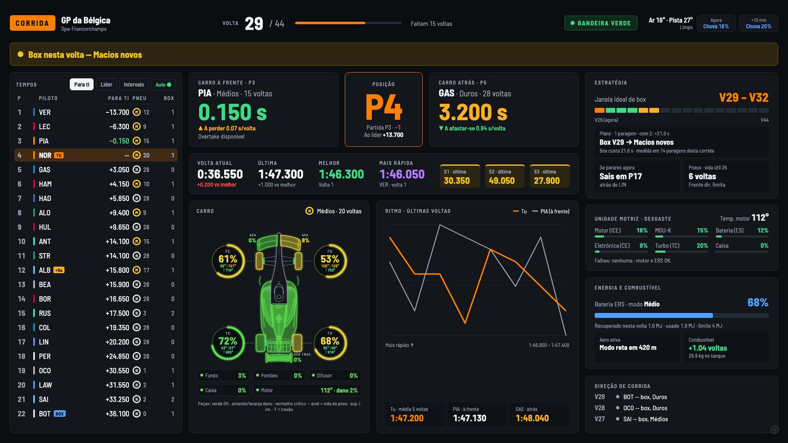
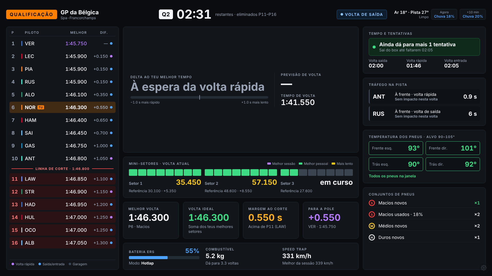
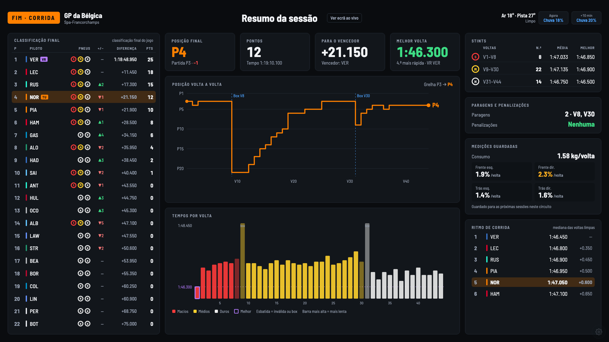
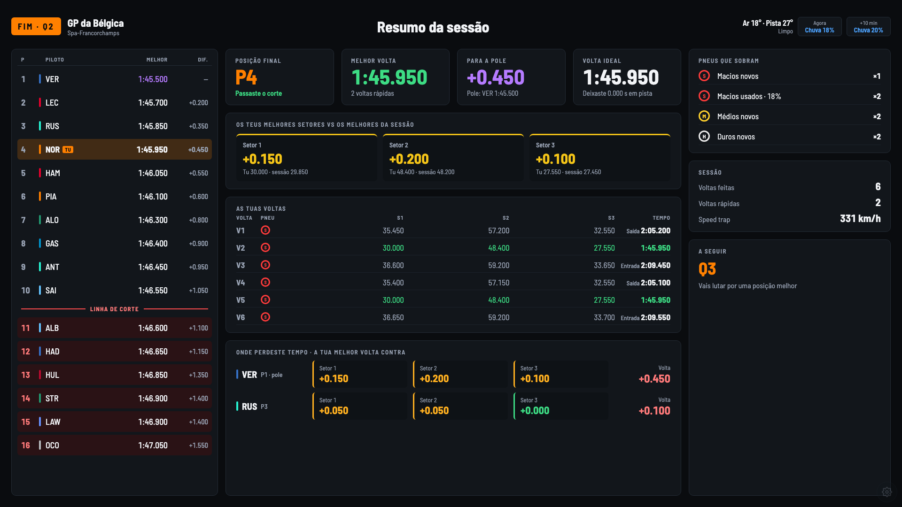
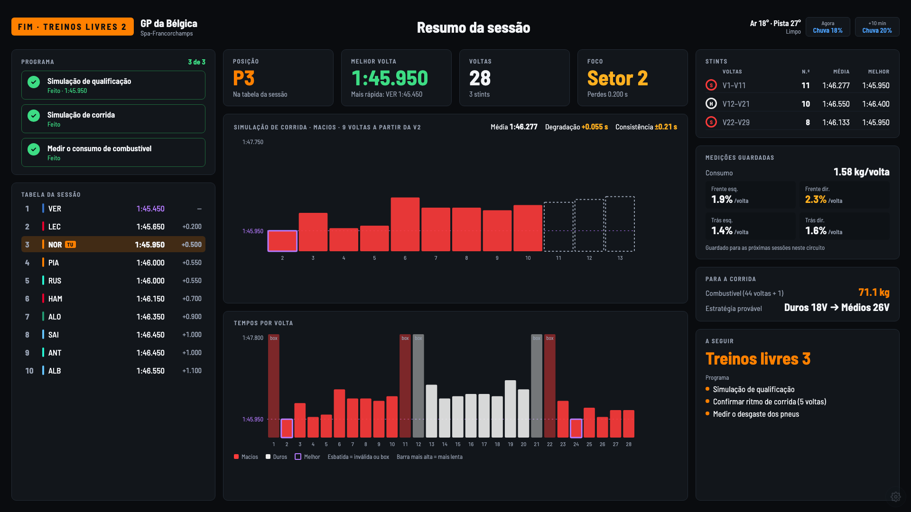
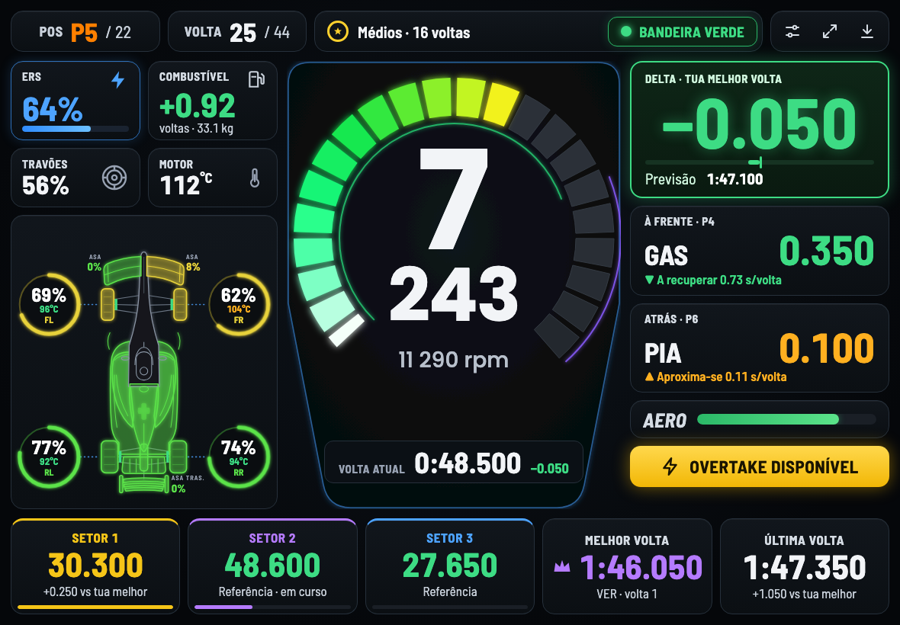
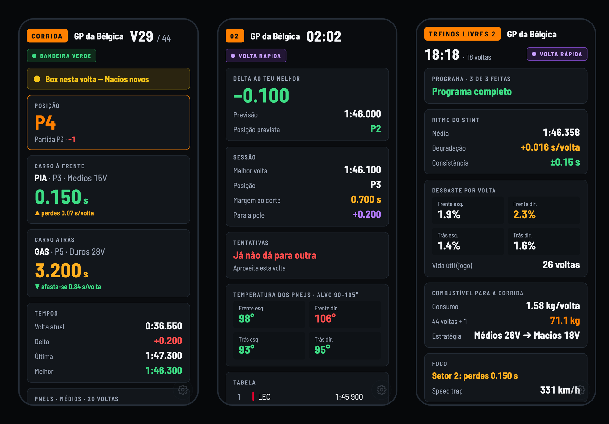
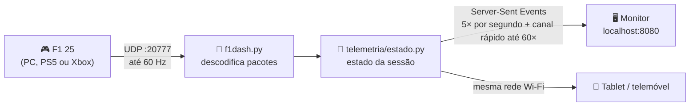

<div align="center">

# 🏎️ F1 Dash

### O teu engenheiro de corrida no segundo monitor

Painel de telemetria em tempo real para o **EA SPORTS F1 25** e o **2026 Season Pack** (também funciona com o **F1 2020**).<br>
Um ecrã próprio para **corrida**, **qualificação** e **treinos livres**, que muda sozinho conforme a sessão.

<br>


[](https://github.com/heldersilva28/f1Dash/actions/workflows/testes.yml)

<br>

[**Começar**](#-começar-em-3-passos) · [**Os ecrãs**](#-os-três-ecrãs) · [**Volante no tablet**](#-volante-no-tablet) · [**Telemóvel**](#-no-tablet-ou-telemóvel) · [**Configurar o jogo**](#-configurar-o-jogo) · [**Problemas**](#-problemas-frequentes)

<br>



<sub>Ecrã de corrida no modo de demonstração, com dados simulados: volta 29, plano a pedir a paragem nesta volta.</sub>

</div>

---

## ✨ Porquê o F1 Dash

<table>
<tr>
<td width="33%" valign="top">

### 🔌 Liga e corre
Sem SimHub, sem programas pagos, sem `pip install`. Só **Python 3.10+** e um duplo clique.

</td>
<td width="33%" valign="top">

### 🧠 Sabe onde estás
Deteta se estás em corrida, qualificação ou treinos e mostra o ecrã certo, sem tocares em nada.

</td>
<td width="33%" valign="top">

### 📡 Dados do próprio jogo
Lê a telemetria UDP oficial da EA, validada contra a especificação dos formatos **2025** e **2026**.

</td>
</tr>
<tr>
<td width="33%" valign="top">

### 🎯 Pensado para decidir
Janela de box, posição à saída do pit, margem para o corte, combustível para a corrida. Números que mudam o que fazes a seguir.

</td>
<td width="33%" valign="top">

### 📱 Monitor, tablet ou telemóvel
Funciona com PC, PS5 ou Xbox. Sem segundo monitor? Abre o painel no tablet ou no telemóvel, com uma vista própria.

</td>
<td width="33%" valign="top">

### 🚨 Alertas de relance
Chuva a caminho, pneus no limite, bandeiras, asa partida, combustível curto: aparecem em grande, por cima de tudo.

</td>
</tr>
</table>

---

## 🚀 Começar em 3 passos

**1. Instala o Python** (só da primeira vez)

Descarrega a versão mais recente em <https://www.python.org/downloads/>. Na primeira janela do instalador, marca **"Add Python to PATH"** (recomendado; se te esqueceres, o `Iniciar.bat` encontra o Python na mesma).

**2. Liga a telemetria no jogo**

Em **Definições → Definições de telemetria**, liga a *Telemetria UDP* na porta `20777`. Tens a tabela completa em [Configurar o jogo](#-configurar-o-jogo).

**3. Abre o painel**

Faz **duplo clique em `Iniciar.bat`**. O painel abre em <http://localhost:8080>. Arrasta a janela para o segundo monitor e carrega **F11**.

> [!TIP]
> **Ainda sem o jogo aberto?** Usa `Iniciar-demo.bat` e escolhe corrida, qualificação ou treinos para ver o painel a funcionar com dados simulados.

<details>
<summary><b>Outras formas de abrir</b></summary>

<br>

Janela sem barras do browser, se tens o Chrome:

```bat
start chrome --app=http://localhost:8080 --start-fullscreen
```

macOS ou Linux, pela linha de comandos:

```bash
python3 f1dash.py
```

Modo demo pela linha de comandos (`corrida`, `qualificacao` ou `treinos`):

```bash
python3 f1dash.py --demo corrida
```

Da primeira vez, o Windows pode perguntar se deixas o Python usar a rede. Escolhe **Permitir**.

</details>

---

## 📸 Os três ecrãs

### 🏁 Corrida


| | |
|---|---|
| **Classificação** | Três vistas: **Para ti** (quem está à frente com "−", atrás com "+"), **Líder** e **Intervalo**. Com **Auto** ligado, alternam a cada 8 s. A tua linha leva a cor da equipa e a etiqueta **TU**. |
| **Carro da frente e de trás** | Diferença, pneus e ritmo comparado com as últimas 5 voltas. Avisa quando o **Overtake** (2026) ou o **DRS** (2025) fica ao alcance. |
| **Tempos** | Volta atual, última, melhor e mais rápida da sessão, com setores a roxo, verde e amarelo. |
| **Carro** | Dano de cada peça. Os anéis mostram vida dos pneus, temperatura de superfície e interior, e travões. |
| **Estratégia** | Ritmo das últimas voltas, janela de box e a posição em que voltas à pista se parares agora (dada pelo jogo). |
| **Plano de corrida** | Diz quando parar e que pneus montar ("Box V26 → Macios novos") e compara com mais uma paragem. Usa o que o jogo envia para cada conjunto (voltas que lhe restam e diferença de ritmo) e o tempo perdido nas boxes, medido nas paragens reais da corrida. |
| **Energia** | Unidade motriz, bateria ERS, aero ativa, combustível e mensagens da direção de corrida. |
| **Vida dos pneus** | As voltas que restam ao conjunto montado, tal como o jogo as calcula. O consumo e o desgaste que mediste nos treinos também passam para a corrida. |

### ⏱️ Qualificação



| | |
|---|---|
| **Tabela com linha de corte** | Ajustada à sessão (Q1, Q2 ou Q3) e ao número de carros. |
| **Saída e entrada** | Os tempos das voltas de saída e de entrada vêm do histórico do jogo, por isso o "ainda dá para mais uma tentativa" funciona desde o início. |
| **Delta ao vivo** | Contra a tua melhor volta do fim de semana: a da Q1 continua a ser a referência na Q2 e na Q3. Com previsão do tempo e da posição. |
| **Mini-setores** | 8 por setor, comparados com a tua melhor volta e com a melhor da sessão. |
| **Números-chave** | Volta ideal, margem para o corte e diferença para a pole. |
| **Gestão da sessão** | Se ainda dá para mais uma tentativa, tráfego à tua volta, temperatura dos pneus e conjuntos disponíveis. |

### 🔧 Treinos livres


**Programa automático da sessão.** Cada tarefa marca-se sozinha com o que fazes em pista e mostra o progresso (por exemplo "5 de 8 voltas seguidas"). O programa segue a estrutura do fim de semana que o jogo envia: num fim de semana com sprint, o único treino leva o programa completo.

| Sessão | Programa |
|---|---|
| **TL1** | Reconhecimento da pista, testar os 3 compostos, medir o desgaste dos pneus |
| **TL2** | Simulação de qualificação, simulação de corrida (8 voltas seguidas), medir o consumo |
| **TL3** | Simulação de qualificação, confirmar o ritmo de corrida (5 voltas), desgaste |
| **Treino único** | Reconhecimento, qualificação, corrida e consumo (fins de semana curtos) |

Também mostra:

- **Stints e ritmo do stint atual:** média, degradação por volta, consistência e projeção das próximas voltas.
- **Setores contra os melhores da sessão** e o speed trap.
- **Desgaste de cada pneu por volta** e a vida útil do composto, dada pelo jogo.
- **Estratégia provável para a corrida**, com os conjuntos de pneus que ainda tens (por exemplo "Duros 18V → Médios 26V").
- **Combustível para a corrida:** consumo por volta e quanto levar.

<details>
<summary><b>Como é que o painel sabe quantas voltas tem a corrida?</b></summary>

<br>

Procura, por esta ordem:

1. o número que o jogo envia;
2. as voltas da última corrida que fizeste nesse circuito;
3. o número oficial de voltas do circuito, ajustado à duração das tuas corridas (o painel aprende-a sozinho na primeira corrida, por exemplo 50%);
4. a distância completa.

As corridas ficam guardadas por circuito **e pela duração escolhida no jogo**: se mudares de 25% para 50%, o painel não se engana. A corrida sprint não conta, porque o painel sabe pela estrutura do fim de semana qual é a corrida principal. O ecrã mostra de onde veio o número. A memória fica em `memoria.json`.

</details>

### 🏁 Fim da sessão

Quando a sessão acaba, o painel mostra sozinho um resumo completo, até começar a sessão seguinte. Os dados vêm do que o jogo envia no fim: a classificação final, as posições volta a volta e o histórico de voltas de todos os carros.

#### Corrida



| | |
|---|---|
| **Classificação final** | Todos os pilotos com a estratégia de pneus, lugares ganhos ou perdidos, diferença para o vencedor, pontos e quem fez a volta mais rápida. |
| **Posição volta a volta** | O gráfico da tua corrida, com as paragens marcadas. |
| **Tempos por volta** | Cada volta com a cor do composto; voltas de box e inválidas esbatidas, a melhor destacada. |
| **Stints e paragens** | Voltas, média e melhor volta de cada stint, paragens e penalizações. |
| **Ritmo de corrida** | Os pilotos mais rápidos em ritmo (mediana das voltas limpas) e onde ficaste. |

#### Qualificação



| | |
|---|---|
| **Classificação** | Com a linha de corte e as diferenças para a pole. |
| **Setores** | Os teus melhores setores contra os melhores da sessão, e a volta ideal. |
| **As tuas voltas** | Cada volta com os setores coloridos (roxo melhor da sessão, verde melhor pessoal) e as voltas de saída e entrada. |
| **Onde perdeste tempo** | A tua melhor volta comparada, setor a setor, com a da pole e a do carro à tua frente. |
| **Pneus que sobram** | Os conjuntos que ainda tens para o resto do fim de semana. |

#### Treinos livres



| | |
|---|---|
| **Programa** | O que fizeste e o que ficou por fazer. |
| **Simulação de corrida** | O stint mais longo, com média, degradação, consistência e projeção. |
| **Tempos por volta** | Todas as voltas da sessão, por composto. |
| **Para a corrida** | Combustível a levar e estratégia provável com os pneus que tens. |
| **A seguir** | A sessão seguinte e o programa que te espera. |

### 🚨 Alertas

Por baixo do cabeçalho aparece uma barra com o que precisas de saber já. Fica visível pelo menos 5 segundos, para não piscar.

| Nível | Exemplos |
|---|---|
| 🔴 **Perigo** | Bandeira vermelha · drive-through ou stop & go por cumprir · delta negativo com Safety Car ou VSC · está a chover e tens pneus de seco · pneus no limite |
| 🟡 **Aviso** | Safety Car / VSC com o delta · bandeira amarela daqui a X metros (pelas zonas dos comissários) · bandeira azul · avisos de limites de pista · box nesta volta, pelo plano · chuva prevista · asa danificada · pneus a sobreaquecer · combustível curto |
| 🔵 **Informação** | Janela de box aberta · modo espectador |

> [!NOTE]
> O botão **⚙** no canto inferior direito abre as definições: escolher o ecrã à mão, escolher a vista (completa, volante ou compacta) e, só se o automático falhar, pôr as voltas da corrida à mão.

---

## 🎛️ Volante no tablet

Com o tablet deitado ao lado do volante, o painel vira o ecrã de um volante de F1: tudo o que precisas a correr, em letras grandes.



| | |
|---|---|
| **Barra de cima** | Posição, volta, pneus montados e o estado da pista: bandeiras, Safety Car e os alertas mais importantes (box nesta volta, chuva, penalizações). |
| **Conta-rotações** | Mudança, velocidade e rotações; as luzes acendem como as do volante do carro (o jogo envia a percentagem). |
| **Carro** | Desgaste de cada pneu em anel, temperatura da superfície e dos travões, e o dano de cada peça. |
| **ERS, combustível, travões, motor** | Bateria, voltas de combustível a mais ou a menos, repartição de travagem e temperatura do motor. |
| **Delta** | Contra a tua melhor volta, com a previsão; fica verde quando vais mais rápido e vermelho quando vais mais lento. |
| **À frente e atrás** | Diferença e se estás a recuperar ou a perder tempo para cada um. |
| **Aero e Overtake** | Quando o modo reta (ou o DRS, nas regras de 2025) fica disponível, e se tens o Overtake. |
| **Setores** | Os setores da volta atual comparados com a tua melhor, o progresso no setor em curso, a volta mais rápida da sessão e a tua última. |

Num tablet deitado, a vista **Volante** abre sozinha (também se escolhe em ⚙). Os três botões da barra de cima abrem as definições, põem em ecrã inteiro e guardam uma imagem do ecrã.

> [!TIP]
> **No iPad**, abre o endereço no Safari e escolhe **Partilhar → Adicionar ao ecrã principal**. O painel passa a abrir como uma app, sem as barras do browser. Para guardar uma imagem do ecrã no iPad, usa o botão de cima e o de volume + ao mesmo tempo (o Safari não deixa o botão de guardar imagem funcionar).

---

## 📱 No tablet ou telemóvel

Ao arrancar, o painel mostra o endereço para usar noutro aparelho:

```text
[OK] No tablet ou telemóvel (mesma rede Wi-Fi): http://192.168.1.20:8080
```



Abre esse endereço no browser do tablet ou do telemóvel, ligado ao mesmo Wi-Fi do PC. Num tablet deitado abre o [volante](#-volante-no-tablet); no telemóvel (ou com o tablet ao alto), o painel passa sozinho para a **vista compacta**: cartões grandes com o essencial (posição, diferenças, tempos, pneus, estratégia) que se leem de relance e se ajustam ao ecrã. Podes ter o PC e o tablet abertos ao mesmo tempo.

> [!TIP]
> Se o tablet não conseguir abrir o endereço, a firewall do Windows está a bloquear. Na primeira vez que abres o painel, escolhe **Permitir** também para redes privadas.

---

## 🎮 Configurar o jogo

No F1 25: **Definições → Definições de telemetria**

| Opção | Valor |
|---|---|
| Telemetria UDP | **Ligada** |
| Modo de difusão UDP | Desligado |
| Endereço IP UDP | `127.0.0.1` se jogas no mesmo PC |
| Porta UDP | `20777` |
| Frequência de envio UDP | 20 Hz ou mais (**60 Hz** é o ideal: o conta-rotações e o delta atualizam a esse ritmo) |
| Formato UDP | **2026** com o 2026 Season Pack, **2025** com os carros de 2025, **2020** no F1 2020 |
| A tua telemetria | Pública ou restrita: os dados do teu carro chegam sempre |

> [!IMPORTANT]
> Se já jogavas F1 25 antes do Season Pack, o formato pode ter ficado em **2025**. Muda-o à mão para **2026**.

<details>
<summary><b>🕹️ No F1 2020</b></summary>

<br>

Em **Game Options → Settings → Telemetry Settings** (ou **Opções → Definições → Telemetria**): *UDP Telemetry* ligada, *UDP Broadcast Mode* desligado, *UDP IP Address* `127.0.0.1` (ou o IP do PC), *UDP Port* `20777`, *UDP Send Rate* **60 Hz** e *UDP Format* **2020**. O painel reconhece o formato sozinho.

O F1 2020 envia menos dados do que o F1 25, e o painel compensa com o que recebe:

| O F1 2020 não envia | O que o painel faz |
|---|---|
| Diferenças para o carro da frente e para o líder | Calcula-as pela hora a que cada carro passa em cada ponto da pista. Nos primeiros segundos depois de abrires o painel aparece "—" até haver dados. |
| Número de paragens | Conta as entradas nas boxes, a partir do momento em que abres o painel. |
| Histórico de voltas | Junta as voltas que vê passar; a melhor volta e os setores de referência vêm logo do jogo. |
| Limites dos setores | Aprende-os no sítio onde o jogo muda de setor. |
| Speed trap | Vem nos eventos do jogo. |
| Conjuntos de pneus, janela de box, duração da corrida, estrutura do fim de semana | Sem esses dados não há plano de corrida; a vida dos pneus vem do desgaste medido. |
| Probabilidade de chuva | O alerta usa o tempo previsto ("Chuva prevista daqui a 20 min"). |

Para experimentar sem o jogo: `python f1dash.py --demo corrida --demo-formato 2020`.

</details>

**🎮 PS5 / Xbox:** em *Endereço IP UDP* põe o IP do PC onde corre o painel. Para o saberes, abre a Linha de Comandos no PC, escreve `ipconfig` e usa o "Endereço IPv4".

---

## 💡 Bom saber

- Alguns valores precisam de **1 ou 2 voltas completas** com o painel aberto: consumo, desgaste por volta, vida dos pneus e delta ao vivo. Até lá aparece "a calcular…".
- O delta ao vivo usa a tua melhor volta **feita com o painel aberto**. Na qualificação, essa volta passa da Q1 para a Q2 e para a Q3.
- O painel aguenta **flashbacks**: quando voltas atrás, o delta e os mini-setores refazem-se a partir desse ponto.
- O consumo e o desgaste por composto ficam guardados por circuito em `memoria.json`. Na corrida, o painel usa-os até ter as suas próprias medições e diz de onde vêm.
- O **modo demo não mexe** na memória: experimentar não estraga o que o painel aprendeu das tuas corridas.
- A ver uma sessão como **espectador**, o painel segue o carro que o jogo está a mostrar.
- O jogo não envia o desgaste dos pneus dos outros carros, por isso só aparece o teu.
- Ao arrancar, o painel confirma o tamanho dos pacotes principais contra a especificação oficial da EA. Dois pacotes que o painel usa no fim da corrida (a classificação final no formato 2026 e as posições volta a volta) ainda não estão confirmados: se o jogo os mandar com outro tamanho, o painel ignora-os e usa os próprios dados, sem falhar.

---

## 🧰 Problemas frequentes

| Sintoma | O que fazer |
|---|---|
| Fica em **"À espera do jogo…"** | Confirma a porta `20777`, o IP e que a telemetria UDP está ligada. Na consola, confirma o IP do PC. |
| **"Estão a chegar dados mas num formato que não conheço"** | Muda o *Formato UDP* para 2026 ou 2025. |
| **"A porta 8080 está ocupada"** | Há outra janela do F1 Dash aberta (ou outro programa na 8080). O painel passa sozinho para a porta seguinte e diz qual usa. |
| **"Não consegui abrir a porta UDP"** | Fecha outros programas de telemetria ou usa outra porta: `python f1dash.py --porta-udp 20778` (e põe a mesma no jogo). |
| Queres usar com outro programa ao mesmo tempo | No jogo, envia para este painel. Se o outro programa tiver reencaminhamento UDP, usa-o. |

<details>
<summary><b>Todas as opções da linha de comandos</b></summary>

<br>

| Opção | Por omissão | Para quê |
|---|---|---|
| `--porta-udp` | `20777` | Porta onde o jogo envia a telemetria |
| `--porta-web` | `8080` | Porta do painel no browser |
| `--demo` | | Simula `corrida`, `qualificacao` ou `treinos` sem o jogo |
| `--demo-formato` | `2026` | Formato dos pacotes da simulação: `2026` (F1 25) ou `2020` (F1 2020) |
| `--sem-browser` | | Não abre o browser ao arrancar |

```bash
python f1dash.py --help
```

</details>

---

## ⚙️ Como funciona



O ecrã atualiza-se a dois ritmos. Mudança, velocidade, rotações, luzes, tempo da volta e delta vêm por um **canal rápido**, ao ritmo a que o jogo os envia (até 60 vezes por segundo), e mudam no sítio sem redesenhar a página. O resto (tabelas, pneus, estratégia) atualiza 5 vezes por segundo, o que chega para valores que mudam devagar.

Tudo corre na tua máquina com a biblioteca padrão do Python. O estado é calculado uma vez e partilhado com todos os ecrãs ligados, por isso o PC e o tablet abertos ao mesmo tempo não pesam mais. O painel é HTML, CSS e JavaScript simples, sem frameworks.

<details>
<summary><b>Estrutura do projeto</b></summary>

<br>

```text
f1Dash/
├── f1dash.py            # arranque: escuta UDP e serve o painel
├── demo.py              # simulador de corrida, qualificação e treinos
├── Iniciar.bat          # atalho para Windows
├── Iniciar-demo.bat     # atalho para o modo demo
├── telemetria/
│   ├── pacotes.py       # leitura dos pacotes UDP (formatos 2025 e 2026)
│   ├── f1_2020.py       # leitura dos pacotes do F1 2020, convertidos para a mesma forma
│   └── estado.py        # estado da sessão, cálculos e estratégia
├── web/
│   ├── index.html
│   ├── app.js           # os três ecrãs
│   ├── carro.js         # desenho do carro e dos pneus
│   ├── volante.js       # vista Volante (tablet deitado)
│   └── estilo.css
├── testes/              # python -m unittest discover -s testes
│   ├── teste_pacotes.py # leitura dos pacotes 2025 e 2026
│   ├── teste_estado.py  # flashbacks, espectador, alertas, memória…
│   ├── teste_2020.py    # formato do F1 2020
│   └── teste_servidor.py
├── .github/workflows/   # testes automáticos em cada push (Windows e Linux)
└── imagens/             # capturas usadas neste README
```

</details>

---

<div align="center">

<sub>Projeto de fãs, sem ligação à EA, à Codemasters ou à Formula 1. F1 e EA SPORTS são marcas dos respetivos donos.</sub>

<br>

**Se o F1 Dash te ajudou a ganhar umas décimas, deixa uma ⭐**

</div>
